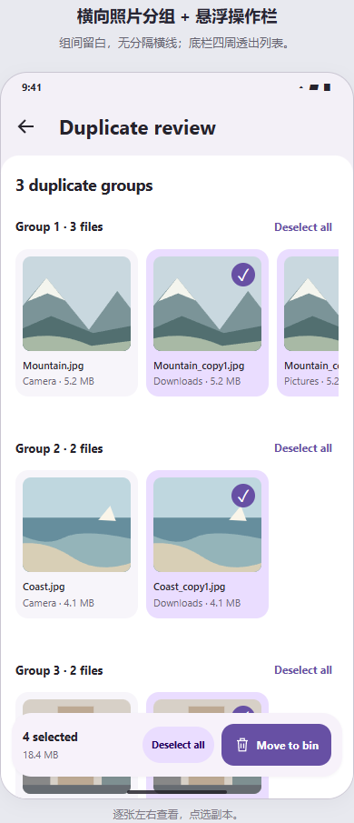
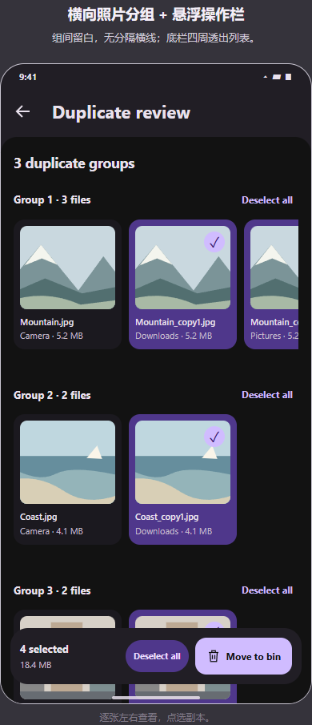

# 去重页面最终方案

采用 07 的横向照片主体与 06 的悬浮操作栏，统一使用应用的新顶栏和圆角主体。

- 顶部保留返回、页面标题；列表上方只显示组数，删除顶部全选、All photos 和说明性小字。
- 每组一行照片，左右滑动查看。组与组之间依靠标题、留白和照片卡片的轻底色区分，不画分隔横线。
- 照片卡包含缩略图、文件名、目录、容量与日期。保留建议放入图片，不另占一行；处理状态提供给辅助功能。未选中不显示选择标记，选中为 26dp 主色实心圆配对比色勾，无外圈描边或方形底座；颜色沿用半页面选中项的 primary/onPrimary。
- 底部只有一条圆角悬浮操作栏，从左至右为选中数量／容量、全选副本／取消全选、移入回收站。阴影降为 1dp，栏的四周和后方透明，列表可以从下面滚过；末尾留出滚动余量，最后一个文件能完整滚到栏上方。
- 配色参考实际导航胶囊与半页面：底栏用半页面的 surfaceContainerLow；全选键用导航选中胶囊的 primaryContainer/onPrimaryContainer，文字加粗；Move to bin 保留主要操作的 primary/onPrimary。沿用现有明暗主题和动态色。
- 每组至少保留一份，移入回收站前仍需确认；扫描、复核、授权、完成和失败状态继续沿用既有流程。
- 全局 toast 实际约上移 16dp，使用柔和主题表面色；统一去掉叉号，左右滑动关闭，保留自动消失与消息队列。

浅色预览：

深色预览：

预览中的图片和文件为设计示例；原生应用的验证记录见 verification.md。
