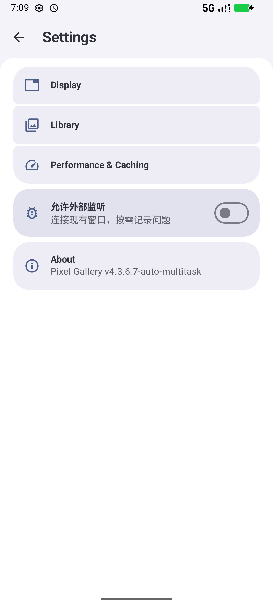
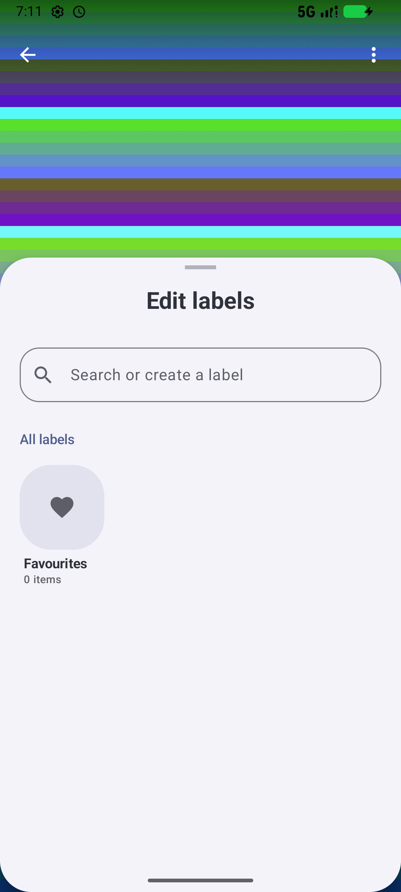
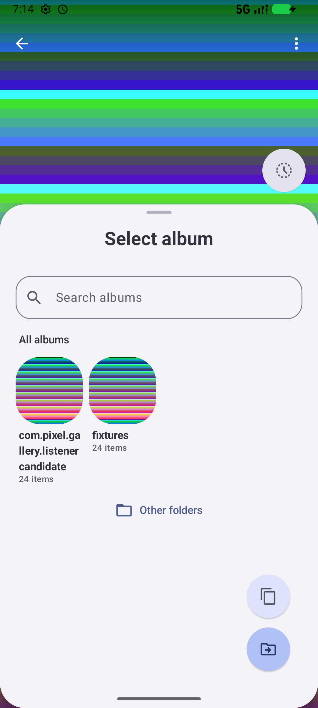

# 图片记忆诊断接口

设置首页的“允许外部监听”是独立色块，包含图标、说明和开关。默认关闭。开启后仅注册接口；电脑监听器的“开启记录”才创建记录器。关闭手机开关同时停止记录。进程退出后接口恢复关闭。

电脑端运行 `python tools/viewer_listener.py`，或 `tools/相册诊断监听器.pyw`。选择已授权设备和应用包名，点击“连接 / 状态”。“读取记录”保存现有窗口和持久记忆的快照；“开启记录”记录后续读取、保存、淘汰、窗口生命周期和转移身份变化。“停止记录”释放记录器。关闭电脑窗口不会停止手机记录。

## 保留现场

监听器不包含安装、启动、停止应用、媒体扫描或页面导航命令。接口只使用动态接收器；请求带 `FLAG_RECEIVER_REGISTERED_ONLY`，接口未开启或应用不在运行时直接失败。连接成功后固定进程 ID，进程变化时报错。接收器要求 Android `DUMP` 权限，由已授权的 ADB shell 调用。

快照按需读取现有窗口、渲染比例、中心点、已有窗口内的记忆和 `viewer_memory`，不调用记忆的读取更新方法、不请求绘制、不保存当前缩放。关闭时不保留窗口注册表、记录队列、监听线程或定时采样。代码内的诊断分支仍有检查开销；实际内存和操作耗时由模拟器对照测试记录。

开始记录前的操作没有历史日志，首次采集能取得当时尚存的窗口和持久状态。记录目录位于应用私有 `files/viewer-memory-diagnostics`，单份日志轮转阈值 4 MiB，保留当前和上一份；导出副本另占对应空间。队列上限 1024，窗口读取去重上限 128，记录线程空闲 2 秒退出。运行中的记录会使用内存、CPU 和存储。

## 协议 2

动作是 `<package>.VIEWER_DIAGNOSTICS_CONTROL`，包范围广播，标记 `0x40000000`。字符串参数 `command` 和 `request_id`。响应是有序广播结果中的 `GALLERY_DIAG_V2:` 加 Base64 UTF-8 JSON；包含协议、包名、请求 ID、进程 ID、接口和记录状态。

- `status` 查询状态。
- `start` / `stop` 开启和停止记录。
- `capture` 按需生成不可变导出副本。
- `read` 读取导出副本；字符串 `resource` 仅接受 `snapshot.json`、`current.log`、`previous.log`，长整型 `offset` 为字节偏移，每块最多 16 KiB。

不支持刷新、任意路径读取或应用控制命令。采集内容包括图片标识、路径和记忆值；保存目录由使用者选择。

## 验证

电脑协议测试：`python tools/diagnostics-tests/test_listener.py`。
Android API 模型测试：给单元测试构建添加 `-I tools/diagnostics-tests/model.init.gradle`，指定 `com.pixel.gallery.ui.viewer.FixedImageZoomMemoryTest`。
真实模拟器测试：`tools/diagnostics-tests/device.init.gradle` 将专用测试驱动加入测试包，用 `-Ddiag.root=<source-root>`、`-Ddiag.package=com.pixel.gallery.listenercandidate` 构建。驱动保留真实 MainActivity、网格、图片解码和手势。`run_device_acceptance.py --serial emulator-... --package com.pixel.gallery.listenercandidate --candidate --output <directory>` 安装完成后运行；只接受专用模拟器包。旧版使用相同驱动及 `listenerbaseline` 包名，不加 `--candidate`。

测试工具自己使用临时控制文件和采样，产品不包含这些功能。真实对照需顺序运行、相同数据、相同构建类型，比较进程、任务、视图、缩放、保存记忆、刷新任务、绘制次数、PSS、堆、线程和窗口切换耗时。界面开关与半页标题另外通过实际 UI 操作验证。

Android 官方资料：[注册接收器限定标记](https://developer.android.com/reference/android/content/Intent#FLAG_RECEIVER_REGISTERED_ONLY)、[现有窗口检查](https://developer.android.com/reference/android/view/inspector/WindowInspector#getGlobalWindowViews())、[内存指标](https://developer.android.com/tools/dumpsys#meminfo)。

## 2026-11-12 模拟器验收

Android 16 / API 36、x86_64、模拟器 37.3.9、2560 MiB、4 核、SwiftShader。旧版来源为提交 `e17e5e8c`，与新版使用同一测试驱动、相同原生库和同一组 4096×3072 JPEG。性能对照使用 debug 构建；应用外的测试驱动包含相同的临时指令轮询与采样。

| 实测项目 | 结果 |
| --- | --- |
| 24 个真实 MainActivity，从图片网格进入并双击放大 | 两次新版运行均保留 24 个窗口，实际比例约 3.79 倍 |
| 接口关闭时尝试连接 | 无响应；进程、窗口、缩放和刷新任务不变 |
| 接口开启后连接、读取快照、开启记录、停止记录 | 两轮中每一步的 PID、Activity/根视图身份、缩放/中心、持久记忆、刷新任务、生命周期计数、绘制次数逐项相等 |
| 现场快照 | 两轮均取得 24 个窗口，71 个页面渲染器的标识与记忆快照，24 个已就绪的放大渲染器 |
| 开启记录后依次切换 24 个旧窗口 | 24 个比例仍约为 3.79 倍；实际日志包含窗口生命周期与记忆 checkpoint/persist |
| 关闭接口后的诊断线程 | 0；未开启记录前的诊断文件占用为 0 |
| 设置首页开关 | 实际点击关闭/开启，电脑收到对应状态；独立色块、图标与开关见下图 |
| 详情页的标签、转移半页 | 实际打开并检查，标题下无当前文件名；转移页同含复制/移动选择 |

| 同一 24 窗口负载 | Java 堆（MiB） | 原生分配（MiB） | 总 PSS（MiB） |
| --- | --- | --- | --- |
| 旧版 4.3.6.6 | 74.94 / 78.52 | 809.74 / 809.77 | 1083.86 / 1086.90 |
| 新版 4.3.6.7 第一次 | 87.82 / 91.61 | 786.51 / 786.54 | 1089.83 / 1092.86 |
| 新版 4.3.6.7 重复 | 72.38 / 75.86 | 786.22 / 786.25 | 1065.41 / 1068.36 |

逐窗返回的耗时中位数，旧版为 194.5 ms，新版两轮为 176.5 / 185.5 ms；开启记录后分别为 175.0 / 186.0 ms。

新版两轮空闲 PSS 的差异约 24 MiB；首轮比旧版多约 6 MiB，重复时比旧版少约 18 MiB。本次未观察到持续的内存增量或切换变慢。默认关闭、连接但不记录、记录空闲时均无诊断常驻线程；文件写入线程在空闲后退出。原有协程线程池和 Binder 池线程数随运行变化。

10.7 秒左右的空闲窗口，进程 CPU 计数旧版增加 84 tick，新版关闭接口两轮均增加 94 tick；连接后增加 89 / 90 tick，记录空闲时增加 94 / 87 tick。测试驱动轮询本身计入这些数值。新增接口的代码与类元数据占用存在，实测没有将其与进程的正常波动单独分离。

[详细数值](viewer-diagnostics-results.json)。原始运行日志、逐窗口快照和失败的工具试跑保存在本地 `scratch/zoom-memory-diagnosis/`，不随代码推送。早期外部 ACTION_VIEW 测试存在零宽高元数据，已经替换为实际网格入口；临时指令文件改为写完后原子重命名，排除测试指令读到半写文件。

本次没有复现用户固定图片的偶发缩回。现场监听记录用于核对实际发生时的图片键、各窗口记忆、持久值和淘汰/转移事件。

正式构建追加检查：非调试 x86_64 Release 包实测通过，监听器图形界面的“连接 / 状态”按钮返回正确状态。接口关闭且进程不存在时请求连接，进程仍不存在；打开接口后，在已放大的真实图片中采集，前后屏幕像素和应用绘制计数相等。多 ABI 状态信息已改为读取实际安装的版本号，x86_64 包返回 6084，与安装信息一致。5 项 Android API 模型测试和 6 项电脑协议测试通过。正式 arm64 包的安装版本号为 4084；未安装到手机。

## 与之前 50 窗口记录的指标对照

此前 `fifty-patched-state-stable6` 的 351.36 MiB 是 Java 堆的阶段采样峰值。50 个详情加主 grid，全部返回后 Java 为 233.73 MiB、原生为 425.17 MiB、总 PSS 为 852.42 MiB；宿主采样的总 PSS 峰值为 1092.00 MiB。[原记录](qa/fifty-window-memory-20261107.md)。

旧负载有 131,014 条媒体和同数标签关系，50 个不同文件，其中 4 张超过 100 MB，其余普通图片为 1856×2304，驱动没有执行放大。本次 24 窗口测试从真实网格打开 4096×3072 图片，全部放大到约 3.79 倍；原生图像内存的负载不同。前后汇报未同时列出三种指标，已经在上表补全。

### 相同 50 窗口负载的最终复测

直接复用之前的 50 窗口驱动、两张大图夹具、131,014 条媒体与同数标签关系，校验两版 50 份文件的字节数/尺寸/大图标记一致。完整执行 Quick Sort、50 次群组开合、8 次刷新、图库记录增删改与恢复、返回全部详情。两版均使用专用 debug 包；监听接口默认关闭。

| 指标（MiB） | 4.3.6.6 | 4.3.6.7 |
| --- | ---: | ---: |
| Java 阶段采样峰值 | 361.12 | 350.90 |
| 全部返回后 Java | 234.28 | 234.75 |
| 全部返回后原生 | 421.73 | 419.29 |
| 全部返回后总 PSS | 857.09 | 854.70 |
| 全程保留的主窗口 | 51 | 51 |
| 正常返回的详情 | 50 | 50 |
| 返回时有效图片绘制记录 | 97 | 99 |
| 返回空图片记录 | 0 | 0 |
| 低内存/意外销毁 | 0 / 0 | 0 / 0 |

最终运行分别保存在 `scratch/zoom-memory-diagnosis/fifty-4366-final` 和 `fifty-4367-final`。此前工具试跑遇到主机 C 盘临时磁盘空间不足，已把本轮只读模拟器临时磁盘放到 D 盘；另一次返回失败的截图确认是系统首次全屏引导夺走焦点，图片已显示，已经关闭系统引导后完整重跑。上述失败记录保留，未混入最终通过统计。引导存在时，候选包的监听接口仍成功采集 52 个现有窗口，未启动记录。

本次相同负载的总 PSS 减少约 2.39 MiB；默认关闭时没有诊断线程、队列或读取去重缓存。24 窗口全部放大与 50 窗口原测试的图片分辨率、缩放和图库规模不同，分别列出结果。
